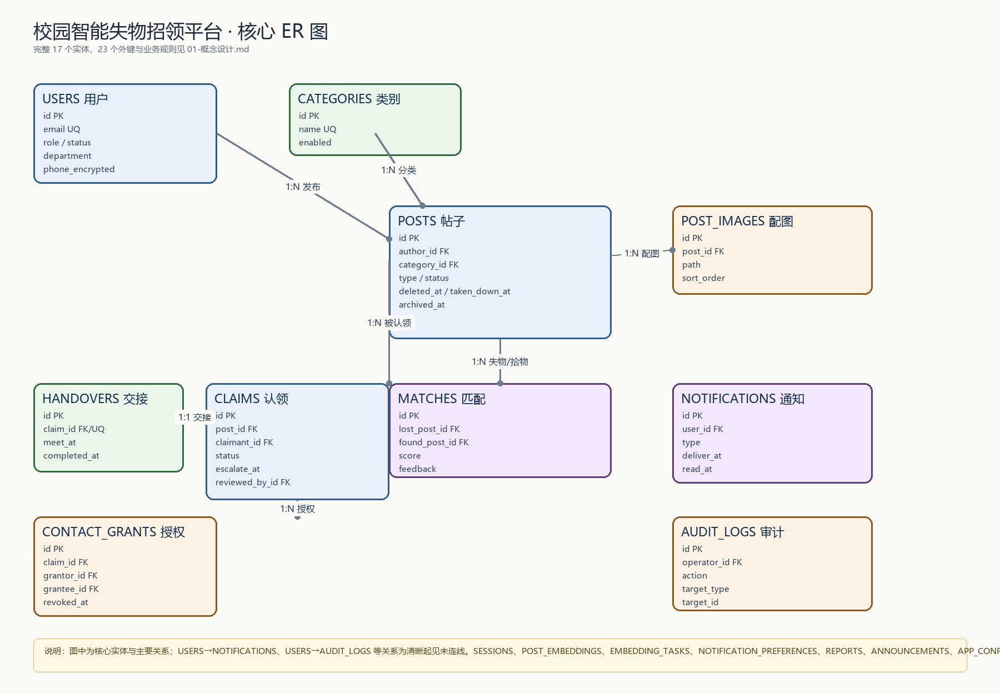

# 校园智能失物招领平台数据库课程设计报告

**课程名称**：数据库原理与应用（待填写）

**学院 / 专业 / 班级**：（待填写）

**指导教师**：（待填写）

**小组成员**：组员 A、组员 B、组员 C（姓名待填写）

**完成日期**：2026 年 11 月

<!-- PAGEBREAK -->

## 摘要

本报告以“校园智能失物招领平台”为背景，在原有 Web 应用基础上完成数据库课程化改造。项目使用 PostgreSQL 18.6，围绕账号、帖子、匹配、认领、交接、通知、举报、公告与审计等业务，设计了 17 张业务表、9 个枚举类型和 23 个外键约束；在此基础上补充视图、物化视图、存储过程/函数、触发器、行级安全、角色授权、并发控制、索引优化与备份恢复。

改造的重点不是重写应用，而是让数据库从“被 ORM 调用的存储”变成设计、计算、约束、事务、安全和运维的主体。最终系统具备以下数据库特性：

- 6 个业务视图、2 个物化视图、4 个数据库函数、3 个触发器；
- `fn_stats` 把统计从 Node 内存聚合下推到 SQL；全量总览使用物化视图，查询约 0.02 ms；
- 认领审核使用行锁与固定加锁顺序，10 轮 × 10 并发实验中没有死锁，每轮恰好一条认领通过；
- 5 个数据库角色、列级授权与 3 张表的 RLS 策略；
- 10 万级基准数据：公开信息流索引提升约 431 倍，中文关键词搜索提升约 40 倍；
- `pg_dump` / `pg_restore` 恢复验证，行数、校验和与数据库对象全部一致。

报告同时给出概念设计、逻辑设计、物理设计、应用集成、并发与隔离实验、安全设计、性能测试、备份恢复、工作量与分工，以及可复现的 SQL 与脚本清单。

**关键词**：PostgreSQL；失物招领；ER 模型；存储过程；触发器；行级安全；索引优化；并发控制

<!-- PAGEBREAK -->

## 目录

1. 项目背景与目标
2. 需求分析与系统架构
3. 数据库概念设计
4. 逻辑设计与规范化
5. 物理设计
6. 数据库编程对象
7. 应用集成
8. 事务与并发
9. 权限与安全
10. 性能测试
11. 备份与恢复
12. 工作量与组员分工
13. 总结与展望
附录 A 主要 SQL 与脚本清单
附录 B 复现命令
附录 C 评分点对照

## 1 项目背景与目标

校园失物招领平台面向“丢失物品—拾获物品—认领—交接”的闭环场景。学生发布寻物启事或拾物信息，系统通过语义匹配把失主与拾主配对；失主提交认领申请并提供凭证，发布者或管理员审核；审核通过后双方在联系方式授权的保护下完成线下交接；管理员负责信息下架、举报处理、公告、统计与账号治理。

原有项目已经具备完整的 Web 应用与业务流程。本次数据库课程设计的目标是：

1. 用数据库课程的方法重新审视数据模型，补充 ER 图、关系模式、函数依赖与规范化分析；
2. 把可在数据库表达的业务规则下沉为约束、函数与触发器；
3. 在不破坏现有应用的前提下，验证事务、并发、隔离级别、权限与性能；
4. 形成可提交、可复现、可答辩的 SQL 与实验材料。

## 2 需求分析与系统架构

### 2.1 业务角色

| 角色 | 主要能力 |
| --- | --- |
| 普通学生 | 注册登录、发布寻物/拾物、浏览搜索、查看匹配、提交认领、安排交接、授权联系方式、接收通知、举报 |
| 帖子作者 | 审核认领、拒绝/通过、安排交接、确认交接完成 |
| 管理员 | 信息下架/恢复/删除、认领超时处理、举报处理、公告、类别与配置、统计报表、账号归档、操作日志 |

### 2.2 系统架构

| 层 | 技术 |
| --- | --- |
| 前端 | Next.js 16 App Router + React 19 + TypeScript + Tailwind CSS 4 |
| 后端 | Next.js Server Actions / Route Handlers |
| 数据访问 | Prisma 6.19.3 |
| 数据库 | PostgreSQL 18.6 |
| 校验 | zod 4 |
| 安全 | scrypt 密码哈希、AES-256-GCM 字段加密、数据库会话、RLS 演示 |

应用与数据库的关系是“应用负责流程与展示，数据库负责一致性、计算、事务与安全”。为避免破坏原有项目，课程化改造使用独立增强展示环境（3001）与独立测试环境（3002）；回归测试只写测试库。

## 3 数据库概念设计

### 3.1 实体清单

共 17 张业务表：

| 实体 | 作用 | 关键属性 |
| --- | --- | --- |
| users | 用户与管理员 | email、role、status、department |
| sessions | 登录会话 | token_hash、expires_at |
| categories | 物品类别 | name、sort_order、enabled |
| posts | 寻物/拾物帖子 | type、status、deleted_at、taken_down_at、archived_at |
| post_images | 帖子配图 | path、size、sort_order |
| post_embeddings | 帖子向量 | vector、model、dim |
| embedding_tasks | 向量化任务 | status、attempts |
| matches | 匹配结果 | lost_post_id、found_post_id、score、feedback |
| claims | 认领申请 | status、escalate_at、reviewer_role |
| handovers | 线下交接 | meet_at、completed_at |
| contact_grants | 联系方式授权 | grantor_id、grantee_id、revoked_at |
| notifications | 站内通知 | type、deliver_at、read_at |
| notification_preferences | 通知偏好 | quiet_start、quiet_end |
| audit_logs | 管理操作日志 | action、target_type、target_id、detail |
| reports | 举报 | reason、status、handled_by_id |
| announcements | 公告 | pinned、published_at、expires_at |
| app_configs | 系统配置 | key、value（JSONB） |

### 3.2 核心 ER 图



完整 ER 图、实体属性与 Mermaid 源码见 01-概念设计.md。核心关系：

- 用户 1:N 帖子、会话、认领、通知、审计日志；
- 类别 1:N 帖子；
- 帖子 1:N 配图、匹配、认领；1:1 向量；
- 匹配由一条 LOST 与一条 FOUND 组成，同一对帖子唯一；
- 认领 1:1 交接，1:N 联系方式授权；
- 同一用户对同一帖子最多一条认领，同一帖子最多一条 ACCEPTED 认领；
- 同一用户对同一对象最多一条举报。

### 3.3 关键业务规则

| 规则 | 数据库保证 |
| --- | --- |
| 邮箱唯一 | users.email 唯一索引 |
| 帖子状态机 | trg_post_status_transition 只允许 OPEN→RESOLVED/CLOSED |
| 匹配一致性 | trg_match_integrity 校验 LOST/FOUND、禁止自匹配与同作者 |
| 一条帖子最多一条通过认领 | 部分唯一索引 claims_one_accepted_per_post |
| 认领通过级联 | fn_review_claim 原子完成接受、拒绝其他、标记帖子、创建交接 |
| 审核审计 | trg_claim_audit 写入 audit_logs |
| 软删除/下架/归档 | 三个时间戳 + 公开视图 + 部分索引 |

## 4 逻辑设计与规范化

### 4.1 关系模式

17 张表的完整关系模式见 02-逻辑设计.md。核心候选键：

| 关系 | 主键 / 候选键 |
| --- | --- |
| users | id；email |
| sessions | id；token_hash |
| categories | id；name |
| posts | id |
| post_images | id；建议 (post_id, sort_order) 唯一 |
| matches | id；(lost_post_id, found_post_id) |
| claims | id；(post_id, claimant_id) |
| handovers | id；claim_id |
| contact_grants | id；(claim_id, grantor_id) |
| reports | id；(reporter_id, target_type, target_id) |
| post_embeddings | post_id |
| notification_preferences | user_id |
| app_configs | key |

### 4.2 规范化分析

- **1NF**：普通列均为原子值；JSONB 与向量数组作为复合值整体读写，属于受控例外。
- **2NF**：复合候选键关系（matches、claims、contact_grants、reports）的非键属性完全依赖整个键。
- **3NF**：category_id、reviewed_by_id 等只存外键，不存储其他实体的可传递属性；JSONB 快照不作为普通非键属性参与传递依赖。
- **BCNF**：核心关系的决定因素均为候选键；`contact_grants.grantee_id` 与认领双方存在受控冗余，由应用层/触发器保持一致。

规范化结论：核心关系达到 3NF/BCNF；主要问题不是范式，而是约束不够强，因此 P2 补充了外键、CHECK、部分唯一索引与触发器。

### 4.3 完整性约束

P2 新增：

- 3 个缺失外键：claims.match_id、handovers.proposed_by_id、handovers.completed_by_id；
- CHECK：score 0~1、禁止自匹配、免打扰小时 0~23、公告过期时间、图片大小、向量维度、多态类型、审核角色、RESOLVED 必须有 resolved_at；
- 唯一索引：post_images(post_id, sort_order)、claims(post_id) WHERE status='ACCEPTED'；
- 部分索引：公开信息流、待审认领、未读通知。

实施中发现一个重要问题：删除审核人时 `ON DELETE SET NULL` 会清空 `reviewed_by_id`，与“已审核必须有审核人”的 CHECK 冲突。最终移除该 CHECK，并放宽交接完成 CHECK，说明约束设计必须同时考虑参照动作。

## 5 物理设计

### 5.1 存储与类型

- 主键使用 TEXT + 应用层 CUID，数据库不生成序列；
- 时间统一为 `timestamp(3) without time zone`，应用写入 UTC；
- 业务文本使用 TEXT，长度由应用层校验；
- JSONB 用于匹配明细、审计上下文、系统配置；
- 向量使用 `double precision[]`，本机无 pgvector，相似度在应用层计算；
- 图片二进制存放在 `storage/uploads`，数据库只存路径与元数据。

### 5.2 索引

P1 基线有 27 个显式索引。P2 新增：

| 索引 | 用途 | P6 实测 |
| --- | --- | --- |
| posts_public_feed_idx | 公开信息流 | 0.02 ms vs 9.91 ms，约 431 倍 |
| posts_title_trgm_idx | 中文关键词搜索 | 1.40 ms vs 56.15 ms，约 40 倍 |
| posts_description_trgm_idx / posts_location_trgm_idx | 描述/地点搜索 | 与标题索引同族 |
| claims_pending_escalate_idx | 待审认领 | 被已有 (status, escalate_at) 覆盖，无可测收益 |
| notifications_unread_idx | 未读通知 | 被已有 (user_id, read_at) 覆盖，无可测收益 |
| claims_one_accepted_per_post | 一条帖子最多一条通过 | 正确性约束 |
| post_images_post_sort_key | 配图顺序唯一 | 正确性约束 |
| matches_created_at_idx / claims_created_at_idx / users_department_idx | 统计时间/院系 | 支撑 fn_stats |

### 5.3 软删除与可见性

`posts` 使用 `deleted_at`、`taken_down_at`、`archived_at` 三个时间戳表达不同语义。公开视图 `v_public_posts` 统一过滤三者，部分索引的谓词与视图条件一致。

### 5.4 安全存储

| 数据 | 存储 |
| --- | --- |
| 登录密码 | scrypt 加盐哈希 |
| 会话令牌 | SHA-256 摘要，库中无原始令牌 |
| 手机号 | AES-256-GCM 密文 + 脱敏值 |
| 认领联系方式 | AES-256-GCM 密文 + 脱敏值 |

密钥在 `.env` 的 `ENCRYPTION_KEY`，不进入数据库备份；换钥会导致旧密文不可读。

## 6 数据库编程对象

### 6.1 视图

| 视图 | 作用 |
| --- | --- |
| v_public_posts | 公开可见帖子 + 作者/类别/封面图 |
| v_claim_detail | 认领 + 帖子 + 申请人 + 审核 + 交接 |
| v_match_overview | 匹配 + 双方帖子 + 作者 |
| v_admin_dashboard | 管理首页汇总指标 |
| v_pending_claims | 待审认领与等待时长 |
| v_unread_notifications | 已送达未读通知 |

### 6.2 物化视图

- `mv_stats_department`：院系用户数、发布量、已解决数、找回率；
- `mv_stats_category`：类别发布量、已解决数、找回率；
- `fn_refresh_stats_mv()` 刷新两个物化视图。

全量总览查询约 0.02 ms，刷新约 250 ms；带时间/院系筛选的实时报表使用 `fn_stats`。

### 6.3 函数与存储过程

| 函数 | 作用 |
| --- | --- |
| fn_review_claim | 行锁 + 权限校验 + 接受/拒绝 + 级联拒绝 + 创建交接 |
| fn_escalate_overdue_claims | FOR UPDATE SKIP LOCKED 批量转交超时认领 |
| fn_complete_handover | 幂等确认交接完成 |
| fn_stats | 统计下推，返回 JSONB |
| fn_refresh_stats_mv | 刷新物化视图 |

认领审核的关键顺序：

```sql
-- 先读 post_id，不加锁
SELECT post_id INTO v_post_id FROM claims WHERE id = p_claim_id;
-- 先锁帖子
SELECT * INTO v_post FROM posts WHERE id = v_post_id FOR UPDATE;
-- 再锁认领
SELECT * INTO v_claim FROM claims WHERE id = p_claim_id FOR UPDATE;
```

### 6.4 触发器

| 触发器 | 作用 |
| --- | --- |
| trg_post_status_transition | 强制帖子状态机 |
| trg_match_integrity | 校验匹配的 LOST/FOUND 与作者 |
| trg_claim_audit | 管理员审核认领写入审计日志 |

## 7 应用集成

| 应用位置 | 实现 |
| --- | --- |
| src/lib/stats.ts | computeStats 调用 fn_stats；旧实现保留为 computeStatsLegacy 用于对比 |
| src/server/claim-actions.ts | 认领审核调用 fn_review_claim；交接完成调用 fn_complete_handover |
| src/lib/claims.ts | 超时转交调用 fn_escalate_overdue_claims |
| 管理审计 | 认领审核审计由 trg_claim_audit 写入 |

统计口径对比脚本在测试库上比较新旧实现，4 个时间范围 × 3 种院系筛选共 12 组完全一致。

## 8 事务与并发

### 8.1 并发认领实验

场景 A：10 个请求抢同一条认领；场景 B：同一帖子 10 条认领并发审核；各 10 轮。

第一次实验发现场景 B 出现 `40P01 deadlock_detected`：原函数先锁认领、再锁帖子，获胜事务更新其他被锁认领会形成环。修复为“帖子 → 认领”的固定顺序后：

```text
场景 A：每轮成功 1，其余 CLAIM_NOT_PENDING
场景 B：每轮成功 1，帖子 RESOLVED，ACCEPTED=1、REJECTED=9
P5 并发认领实验通过：每轮恰好一个请求成功，未出现死锁或未处理异常
```

### 8.2 隔离级别实验

| 隔离级别 | 不可重复读 | 幻读 | 丢失更新 | 最终值 |
| --- | --- | --- | --- | --- |
| READ COMMITTED | before → after | 1 → 2 | 更新成功（覆盖对方） | 1 |
| REPEATABLE READ | before → before | 1 → 1 | 40001 序列化失败 | 10 |
| SERIALIZABLE | before → before | 1 → 1 | 40001 序列化失败 | 10 |

脏读实验：PostgreSQL 的 READ UNCOMMITTED 等同于 READ COMMITTED，读到已提交值，没有脏读；这一点与 MySQL InnoDB 不同。

## 9 权限与安全

### 9.1 角色

| 角色 | 职责 |
| --- | --- |
| clfp_owner | 运维/DDL 权限组（实际属主仍为 clfp） |
| clfp_app | 应用 DML，无 DDL |
| clfp_stats | 统计视图/物化视图 + fn_stats，基础表仅列级授权 |
| clfp_readonly | 公开只读视图与用户公开列 |
| clfp_rls_demo | RLS 演示，只授予必要列 |

### 9.2 RLS

对 notifications、claims、contact_grants 启用行级安全，策略使用 `current_setting('app.current_user_id', true)`：

- 用户只能看自己的通知；
- 认领对申请人或帖子作者可见；
- 联系方式授权对授权方或被授权方可见；
- 统计角色通过 claims_stats_all 读取聚合所需行；
- 应用/运维角色有显式放行策略，表属主 clfp 未使用 FORCE RLS，因此现有应用不受影响。

演示脚本 roles-demo 共 16 项检查全部通过。实施中发现 `fn_stats` 使用 `SELECT *` 会要求整表权限，已改为显式列清单；列级授权与 SECURITY INVOKER 必须配合显式列。

## 10 性能测试

### 10.1 数据规模

独立基准库 clfp_bench：10 万用户、10 万帖子、10 万匹配、10 万认领、10 万通知。

### 10.2 结果

| 查询 | 有索引 | 无索引 | 提升 |
| --- | --- | --- | --- |
| 公开信息流 | 0.02 ms | 9.91 ms | 约 431 倍 |
| 中文关键词搜索 | 1.40 ms | 56.15 ms | 约 40 倍 |
| 待审认领队列 | 0.03 ms | 0.02 ms | 无 |
| 未读通知计数 | 0.04 ms | 0.03 ms | 无 |
| fn_stats 全部时间 | 3532 ms | — | — |
| fn_stats 最近 30 天 | 1206 ms | — | — |
| 院系物化视图 | 0.02 ms | — | — |
| 类别物化视图 | 0.03 ms | — | — |

结论：公开信息流与中文搜索索引收益显著；认领队列与未读通知被已有复合索引覆盖；全量统计应使用物化视图，带筛选报表使用 fn_stats。

## 11 备份与恢复

使用 `pg_dump --format=custom` 备份 clfp_enhanced，恢复到临时库 clfp_restore_check，对比：

- 用户、帖子、图片、匹配、认领、交接、授权、通知、审计、公告、类别行数；
- users/posts/claims/matches 校验和；
- 视图 6、物化视图 2、触发器 3、RLS 策略 10、启用 RLS 表 3。

全部一致，备份文件约 90 KB。图片目录、ENCRYPTION_KEY、集群级角色需要单独备份；生产环境建议开启 WAL 归档与 PITR。

## 12 工作量与组员分工

### 12.1 工作量概览

| 项目 | 数量 |
| --- | --- |
| 业务表 | 17 |
| 枚举 | 9 |
| 外键 | 23 |
| 视图 | 6 |
| 物化视图 | 2 |
| 函数/存储过程 | 4 + 1 刷新函数 |
| 触发器 | 3 |
| 数据库角色 | 5 |
| RLS 策略 | 10 |
| Prisma 迁移 | 16 |
| 设计/实验文档 | 10+ 份 |
| 自动化验证 | M1 35 项 + E2E 241 项 + 管理员认领 + 统计 + 12 组口径对比 + 16 项角色演示 + 并发/隔离实验 |

### 12.2 组员分工

| 组员 | 分工 | 主要产出 |
| --- | --- | --- |
| 组员 A | 需求分析、概念设计、逻辑设计与规范化、数据字典、报告统稿 | ER 图、关系模式、范式分析、数据字典 |
| 组员 B | 数据库对象、应用集成、统计下推、触发器与物化视图 | 视图/函数/触发器/物化视图、stats/claim 集成 |
| 组员 C | 事务并发、权限 RLS、性能测试、备份恢复、测试与演示 | 并发/隔离实验、roles-demo、10 万级基准、备份验证、演示脚本 |

## 13 总结与展望

本次改造保留了原有 Web 应用，把数据库能力系统化地补齐：设计文档、视图、函数、触发器、物化视图、约束、索引、RLS、角色、并发实验、性能测试与备份恢复。实际验证表明：

- 数据库函数能显著简化应用层事务，减少多步更新遗漏；
- 行锁顺序是并发正确性的关键，顺序错误会在真实并发下暴露死锁；
- 列级授权与 SECURITY INVOKER 必须配合显式列清单；
- 统计下推适合带筛选的实时报表，全量总览更适合物化视图；
- 10 万级数据下索引选择必须用执行计划验证，不能只看“有没有索引”。

后续可继续改进：

- 使用 pgvector 替代应用层向量相似度（需安装扩展）；
- 为统计报表增加按时间分区的汇总表或增量物化视图；
- 将通知生成下沉为触发器并完善去重；
- 在生产环境启用按请求设置 app.current_user_id 的强制 RLS；
- 配置 WAL 归档与 PITR，完善备份自动化与演练。

## 附录 A 主要 SQL 与脚本清单

| 文件 | 内容 |
| --- | --- |
| db/sql/00_schema.sql | P1 基线 DDL 快照 |
| db/sql/01_constraints_indexes.sql | 约束与索引 |
| db/sql/02_views.sql | 业务视图 |
| db/sql/03_functions.sql | 函数/存储过程 |
| db/sql/04_triggers.sql | 触发器 |
| db/sql/05_materialized_views.sql | 物化视图与刷新 |
| db/sql/06_roles_rls.sql | 角色、授权、RLS |
| db/sql/07_benchmark_data.sql | 10 万级数据生成 |
| scripts/db/smoke-p2.sql | P2 冒烟测试 |
| scripts/db/verify-stats-parity.ts | 统计口径对比 |
| scripts/db/roles-demo.ts | 角色与 RLS 演示 |
| scripts/db/concurrency-claim.ts | 并发认领实验 |
| scripts/db/isolation-levels.ts | 隔离级别实验 |
| scripts/db/generate-data.ts | 基准数据生成 |
| scripts/db/benchmark.ts | 性能基准 |
| scripts/db/backup-restore.ps1 | 备份恢复验证 |
| scripts/db/export-report-docx.py | 报告导出 Word |

## 附录 B 复现命令

```bash
# 安装与基线
npm install
npx prisma migrate deploy
npm run db:seed

# 测试环境（3002）
cd "D:\ClaudeCodeProjects\校园失物招领-test"
BASE_URL=http://127.0.0.1:3002 npm run verify:e2e
BASE_URL=http://127.0.0.1:3002 npm run verify:admin-claims
BASE_URL=http://127.0.0.1:3002 npm run verify:stats

# P4 角色与 RLS（需临时 CREATEROLE）
psql "$DATABASE_URL" -v ON_ERROR_STOP=1 -f db/sql/06_roles_rls.sql
npx tsx scripts/db/roles-demo.ts

# P5 并发与隔离
npx tsx scripts/db/concurrency-claim.ts
npx tsx scripts/db/isolation-levels.ts

# P6 基准
DATABASE_URL="postgresql://.../clfp_bench" npx tsx scripts/db/generate-data.ts
DATABASE_URL="postgresql://.../clfp_bench" npx tsx scripts/db/benchmark.ts

# P7 备份恢复
powershell -NoProfile -ExecutionPolicy Bypass -File scripts/db/backup-restore.ps1
```

## 附录 C 评分点对照

| 评分点 | 对应内容 | 主要证据 |
| --- | --- | --- |
| 需求分析 | 25 条需求、角色与业务规则 | README、01-概念设计 |
| 概念设计 | 17 实体、ER 图、关系与基数 | 01-概念设计、ER 图 |
| 逻辑设计 | 关系模式、候选键、1NF~BCNF | 02-逻辑设计 |
| 物理设计 | 存储、索引、软删除、加密 | 03-物理设计 |
| 数据库实施 | 16 个迁移、DDL、种子与约束 | prisma/migrations、00_schema.sql |
| 数据库编程 | 6 视图、2 物化视图、4 函数、3 触发器 | 02/03/04/05 SQL |
| 事务与并发 | 行锁、死锁修复、隔离级别 | 06-事务与并发实验 |
| 安全与权限 | 5 角色、列级授权、RLS | 07-权限与安全设计、roles-demo |
| 性能优化 | 10 万级数据、EXPLAIN 对比 | 08-性能测试报告 |
| 备份恢复 | 备份、恢复、校验、PITR 说明 | 09-备份与恢复 |
| 应用集成 | 统计、认领、转交、交接接入数据库函数 | src/lib、src/server |
| 工作量与分工 | 文档、SQL、脚本、自动化验证 | 11-工作量与评分点对照 |