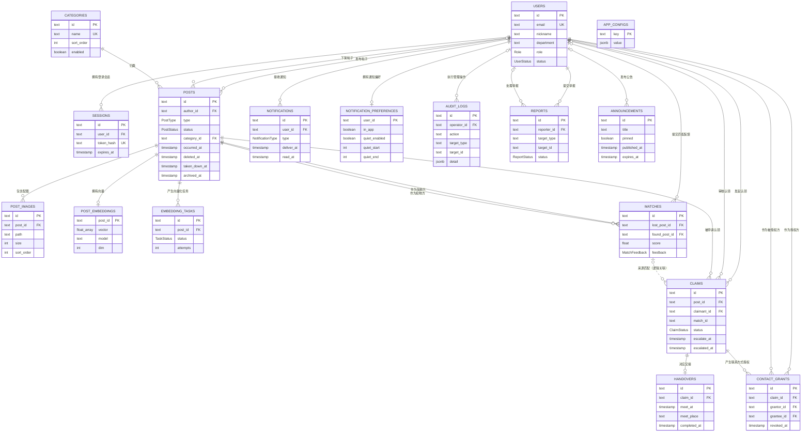

# 01 概念设计

## 1. 项目背景与建模范围

“校园智能失物招领平台”（CLFP）面向校园内丢失与拾获物品的匹配场景。学生发布寻物启事（`LOST`）或拾物信息（`FOUND`），系统通过语义匹配把双方配对；失主提交认领申请并提供凭证，发布者或管理员审核；审核通过后双方可在站内通知与联系方式授权的保护下完成线下交接；管理员负责信息下架、举报处理、公告、统计与账号治理。

数据库课程设计关注的是支撑上述业务的**数据模型、完整性约束、事务边界、查询与安全设计**，而不是前端页面本身。概念设计阶段需要回答三个问题：

1. 系统中有哪些稳定的实体，它们的标识是什么；
2. 实体之间存在哪些一对多、一对一关系，关系的参与是否可选；
3. 哪些业务规则必须在数据库层表达，哪些由应用层保证。

## 2. 建模范围与边界

| 范围 | 说明 |
| --- | --- |
| 纳入 | 账号、会话、物品类别、帖子与配图、向量与向量化任务、匹配、认领、交接、联系方式授权、通知与偏好、审计日志、举报、公告、系统配置 |
| 不纳入 | 前端展示状态、图片二进制内容（存文件系统，数据库只存路径与元数据）、RAG 模型的网络调用细节、邮件服务 |
| 历史数据 | 软删除、下架、归档的帖子仍保留在库中，用于审计与统计；不物理删除 |
| 多租户 | 单校部署，不建模学校/租户维度；院系以文本字段保存 |

## 3. 实体清单

共 17 张业务表，另有 Prisma 迁移管理表 `_prisma_migrations` 不属于业务模型。

| 实体（表） | 中文名 | 主要职责 | 关键属性 |
| --- | --- | --- | --- |
| `users` | 用户 | 学生与管理员账号、校内身份、角色与状态 | `id`、`email`、`role`、`status`、`department` |
| `sessions` | 登录会话 | 持久化登录态，支持禁用账号后立即失效 | `token_hash`、`expires_at` |
| `categories` | 物品类别 | 证件、电子产品等分类，可后台增停 | `name`、`sort_order`、`enabled` |
| `posts` | 帖子 | 寻物启事 / 拾物信息，含状态机与多种可见性标记 | `type`、`status`、`occurred_at`、`deleted_at`、`taken_down_at`、`archived_at` |
| `post_images` | 帖子配图 | 一条帖子 1~6 张图的元数据 | `path`、`mime_type`、`size`、`sort_order` |
| `post_embeddings` | 帖子向量 | 与帖子 1:1 的语义向量与生成元数据 | `post_id`、`vector`、`model`、`dim` |
| `embedding_tasks` | 向量化任务 | 发布/编辑后异步生成向量的任务队列 | `status`、`attempts`、`error` |
| `matches` | 匹配结果 | 一条失物与一条拾物的配对及置信度 | `lost_post_id`、`found_post_id`、`score`、`feedback` |
| `claims` | 认领申请 | 认领说明、凭证、加密联系方式、审核与超时转交 | `status`、`escalate_at`、`escalated_at`、`reviewer_role` |
| `handovers` | 线下交接 | 与认领 1:1 的见面时间、地点、完成确认 | `meet_at`、`meet_place`、`completed_at` |
| `contact_grants` | 联系方式授权 | 认领通过后双方各自决定是否展示联系方式 | `grantor_id`、`grantee_id`、`revoked_at` |
| `notifications` | 站内通知 | 匹配、认领、交接等事件的通知与送达时间 | `type`、`deliver_at`、`read_at` |
| `notification_preferences` | 通知偏好 | 站内/邮件开关与免打扰时段 | `quiet_start`、`quiet_end` |
| `audit_logs` | 管理操作日志 | 管理员下架、恢复、删除、配置变更等的追加日志 | `action`、`target_type`、`target_id`、`detail` |
| `reports` | 举报 | 用户对信息的举报与管理员处理结果 | `reason`、`status`、`handled_by_id` |
| `announcements` | 平台公告 | 首页公告、置顶与过期时间 | `pinned`、`published_at`、`expires_at` |
| `app_configs` | 系统配置 | 匹配阈值、权重、模型选择等键值配置 | `key`、`value`（JSONB） |

## 4. ER 图

下图使用 Mermaid `erDiagram` 语法。`||` 表示恰好一端，`|o` 表示零或一端，`o{` 表示零或多端；实线为有外键约束的关系，虚线为逻辑关联（数据库中无外键）。

> 说明：`claims.match_id` 在数据库中目前只是普通文本列，没有外键约束；`handovers.proposed_by_id`、`handovers.completed_by_id` 也未建外键；`reports` 与 `audit_logs` 的 `target_type/target_id` 是多态指针，无法直接建外键。这些是概念设计中的“逻辑关系”，P2 会补上可补的外键，并用检查约束约束多态类型。

## 5. 关系说明

### 5.1 用户与账号

| 关系 | 基数 | 外键 | 删除策略 | 说明 |
| --- | --- | --- | --- | --- |
| `users` — `sessions` | 1 : 0..N | `sessions.user_id → users.id` | CASCADE | 删除用户级联删除会话 |
| `users` — `posts`（作者） | 1 : 0..N | `posts.author_id → users.id` | CASCADE | 删除用户级联删除其帖子（实际业务使用软删除，不轻易删用户） |
| `users` — `posts`（下架人） | 0..1 : 0..N | `posts.taken_down_by_id → users.id` | SET NULL | 管理员注销后保留帖子 |
| `users` — `claims`（申请人） | 1 : 0..N | `claims.claimant_id → users.id` | CASCADE | 删除用户级联删除其认领 |
| `users` — `claims`（审核人） | 0..1 : 0..N | `claims.reviewed_by_id → users.id` | SET NULL | 审核人注销后保留审核记录 |
| `users` — `matches`（反馈人） | 0..1 : 0..N | `matches.feedback_by_id → users.id` | SET NULL | 反馈人注销不影响匹配 |
| `users` — `notifications` | 1 : 0..N | `notifications.user_id → users.id` | CASCADE | 删除用户级联删除通知 |
| `users` — `notification_preferences` | 1 : 0..1 | `notification_preferences.user_id → users.id` | CASCADE | 偏好可选，未设置时使用默认值 |
| `users` — `contact_grants`（授权方） | 1 : 0..N | `contact_grants.grantor_id → users.id` | CASCADE | — |
| `users` — `contact_grants`（被授权方） | 1 : 0..N | `contact_grants.grantee_id → users.id` | CASCADE | — |
| `users` — `audit_logs` | 0..1 : 0..N | `audit_logs.operator_id → users.id` | SET NULL | 操作人注销后日志保留 |
| `users` — `reports`（举报人） | 1 : 0..N | `reports.reporter_id → users.id` | CASCADE | — |
| `users` — `reports`（处理人） | 0..1 : 0..N | `reports.handled_by_id → users.id` | SET NULL | — |
| `users` — `announcements` | 0..1 : 0..N | `announcements.created_by_id → users.id` | SET NULL | 公告发布人注销后公告保留 |

### 5.2 帖子与内容

| 关系 | 基数 | 外键 | 删除策略 | 说明 |
| --- | --- | --- | --- | --- |
| `categories` — `posts` | 1 : 0..N | `posts.category_id → categories.id` | RESTRICT | 有帖子的类别不允许物理删除，只能停用 |
| `posts` — `post_images` | 1 : 0..N | `post_images.post_id → posts.id` | CASCADE | 每条帖子 1~6 张图（应用层校验） |
| `posts` — `post_embeddings` | 1 : 0..1 | `post_embeddings.post_id → posts.id` | CASCADE | 向量与帖子 1:1 |
| `posts` — `embedding_tasks` | 1 : 0..N | `embedding_tasks.post_id → posts.id` | CASCADE | 同一帖子可因编辑产生多个任务 |
| `users` — `categories` | — | — | — | 无直接关系；类别由管理员维护 |

### 5.3 匹配、认领与交接

| 关系 | 基数 | 外键 | 删除策略 | 说明 |
| --- | --- | --- | --- | --- |
| `posts` — `matches`（失物方） | 1 : 0..N | `matches.lost_post_id → posts.id` | CASCADE | 一条失物可匹配多条拾物 |
| `posts` — `matches`（拾物方） | 1 : 0..N | `matches.found_post_id → posts.id` | CASCADE | 一条拾物可匹配多条失物 |
| `matches` — `claims` | 0..1 : 0..N | 逻辑字段 `claims.match_id` | 无外键 | 认领可记录“从哪条匹配发起”，P2 补外键 `ON DELETE SET NULL` |
| `posts` — `claims` | 1 : 0..N | `claims.post_id → posts.id` | CASCADE | 同一帖子多人认领，应用层保证最多一条通过 |
| `claims` — `handovers` | 1 : 0..1 | `handovers.claim_id → claims.id` | CASCADE | 认领通过后创建交接记录 |
| `claims` — `contact_grants` | 1 : 0..N | `contact_grants.claim_id → claims.id` | CASCADE | 双方可各自授权 |
| `users` — `handovers` | 逻辑 | `proposed_by_id`、`completed_by_id` | 无外键 | P2 补 `ON DELETE SET NULL` 外键 |

### 5.4 治理类

| 关系 | 基数 | 外键 | 删除策略 | 说明 |
| --- | --- | --- | --- | --- |
| `reports.target_id` | 多态 | 无外键 | — | 目前只举报帖子；`target_type` 预留给用户等对象 |
| `audit_logs.target_id` | 多态 | 无外键 | — | 可指向帖子、用户、认领、类别、配置 |
| `announcements` | 独立实体 | — | — | 与帖子无直接关系 |

## 6. 业务规则

以下规则需要在概念层明确，P2 会把其中可在数据库表达的部分下沉为约束、触发器或存储过程。

| 编号 | 规则 | 当前保证方式 | P2 计划 |
| --- | --- | --- | --- |
| BR-01 | 邮箱全局唯一 | `users_email_key` 唯一索引 | 保持 |
| BR-02 | 账号状态只有正常、禁用、归档 | `UserStatus` 枚举 | 保持 |
| BR-03 | 帖子类型只有寻物、拾物 | `PostType` 枚举 | 保持 |
| BR-04 | 帖子状态机：寻找中 → 已解决 / 已关闭，结束后不可回到寻找中 | 应用层校验 | `trg_post_status_transition` 触发器 |
| BR-05 | 删除为软删除，`deleted_at` 非空后不再公开 | 应用查询条件 | 视图 `v_public_posts` 统一封装 + 部分索引 |
| BR-06 | 下架可恢复，下架后作者与管理员仍可见 | 应用查询条件 | 视图 + 触发器审计 |
| BR-07 | 归档后未完成帖子不再公开，管理员仍可查询 | 应用查询条件 | 视图 |
| BR-08 | 一条匹配必须一端是 `LOST`、一端是 `FOUND`，且不能自匹配 | 应用层生成匹配时保证 | `trg_match_integrity` 触发器 + `CHECK (lost_post_id <> found_post_id)` |
| BR-09 | 同一对失物/拾物只能有一条匹配 | `matches_lost_post_id_found_post_id_key` | 保持 |
| BR-10 | 同一用户对同一帖子只能有一条认领记录 | `claims_post_id_claimant_id_key` | 保持；被拒绝或撤回后可复用原记录重新申请 |
| BR-11 | 不能认领自己发布的帖子 | 应用层校验 | 触发器可选（需要跨表查询） |
| BR-12 | 认领通过后：帖子标记已解决、同帖其他待审申请自动拒绝、创建交接记录 | 应用事务 | `fn_review_claim` 存储过程原子完成 |
| BR-13 | 一条帖子最多只能有一条 `ACCEPTED` 认领 | 应用事务 + 条件更新 | 部分唯一索引 `WHERE status = 'ACCEPTED'` |
| BR-14 | 作者 48 小时未处理，认领自动转交管理员 | 页面加载时懒执行 | `fn_escalate_overdue_claims()` 批量函数 |
| BR-15 | 认领联系方式加密存储，页面只展示脱敏值 | 应用层 AES-256-GCM | 保持；数据库只存密文与脱敏值 |
| BR-16 | 联系方式需要双方互相授权才可见 | `contact_grants` + 应用层权限判断 | 保持；P4 可用 RLS 演示行级隔离 |
| BR-17 | 同一用户对同一对象只能举报一次 | `reports_reporter_id_target_type_target_id_key` | 保持；补 `target_type` 检查约束 |
| BR-18 | 管理操作日志只增不改 | 应用只插入 | 触发器 + 回收 UPDATE/DELETE 权限 |
| BR-19 | 公告过期后不再展示 | 应用按 `expires_at` 过滤 | 视图 + `CHECK (expires_at > published_at)` |
| BR-20 | 通知在免打扰时段内推迟送达 | 应用层计算 `deliver_at` | 保持；可用生成列/函数演示 |

## 7. 概念设计取舍

### 7.1 为什么软删除而不是物理删除

帖子存在匹配、认领、通知、统计与审计等下游引用。物理删除会触发大量级联删除，导致历史统计与审计断链；因此 `posts` 使用 `deleted_at`、`taken_down_at`、`archived_at` 三个时间戳表达不同语义：

- `deleted_at`：作者删除或管理员删除，不可由作者恢复；
- `taken_down_at`：管理员下架，可恢复；作者与管理员仍可见；
- `archived_at`：账号毕业/离职归档后，未完成帖子不再公开。

三者不是同一维度的状态，不能合并成一个 `status` 字段；否则“已下架但未删除”“已归档但已解决”等组合无法表达。

### 7.2 为什么匹配与认领是独立实体

匹配是“系统推荐”的结果，认领是“用户主动申请”的行为。一条匹配可能没有认领，一条认领也可能不是从匹配发起（用户直接搜索到帖子后认领）。两者生命周期不同，因此分开建模，`claims.match_id` 只作为可选来源标记。

### 7.3 为什么保留 JSONB 字段

`matches.detail` 保存打分明细（向量相似度、类别、地点、时间、关键词各维度分数），`audit_logs.detail` 保存操作上下文，`app_configs.value` 保存可变配置。这些字段的共同特点是：

- 结构随业务动作变化，字段集合不稳定；
- 主要用途是快照与回溯，不需要被其他表外键引用；
- 拆成多张子表会带来大量稀疏列和连接开销，收益很低。

因此采用 JSONB，并在应用层用 zod 校验结构。概念上它们仍是“依赖于主键的非键属性”，不违反 3NF。

### 7.4 为什么向量用数组而不是子表

`post_embeddings.vector` 是定长浮点数组，作为“一个向量值”整体读写，不会按维度单独查询。拆成 `(post_id, dim_index, value)` 子表会把一行变成数百行，读取时需要聚合，性能与存储都不划算。PostgreSQL 的数组类型可以视为复合值，本设计把它当作原子属性处理；这是对经典 1NF 的工程化取舍，P2 文档会进一步说明。

### 7.5 为什么院系暂不单独建表

当前 `users.department` 只是展示与统计维度，没有院系编码、负责人、联系方式等属性。若强行建 `departments` 表，只会得到一个 `(id, name)` 的两列表，反而增加连接。若后续需要院系元数据，再按 3NF 拆分即可；这是有意的阶段性简化。

### 7.6 多态指针的代价

`reports` 与 `audit_logs` 用 `target_type + target_id` 指向不同实体，无法建立数据库外键。代价是可能产生悬空引用；收益是新增可举报/可审计对象时不需要改表结构。P2 会用 `CHECK` 约束限定 `target_type` 的取值，并在应用层做存在性校验。